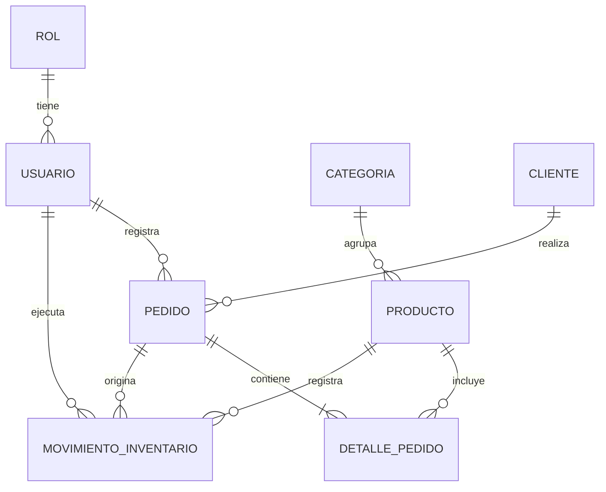

# StockFlow

Sistema de gestión de pedidos e inventario para una distribuidora de productos. Permite administrar el catálogo, registrar clientes, tomar pedidos y llevar el control del stock mediante movimientos de inventario, con acceso diferenciado por rol.

Proyecto full stack: API REST con Spring Boot y frontend en Angular.

## Tecnologías

**Backend**
- Java 21
- Spring Boot 4.1.1 (Spring MVC, API REST)
- Spring Security + JWT (jjwt)
- Spring Data JPA (Hibernate)
- PostgreSQL
- MapStruct (mapeo entre entidades y DTOs)
- Bean Validation
- springdoc-openapi (documentación interactiva con Swagger UI)
- Maven

**Frontend**
- Angular (componentes standalone, signals y carga diferida de rutas)
- CSS plano, sin librerías de UI

## Funcionalidades

- Autenticación con JWT y autorización por roles.
- Gestión de usuarios (solo administrador).
- CRUD de categorías, productos y clientes, con búsqueda, filtros y paginación.
- Pedidos con varias líneas, cálculo de totales en el servidor y estados `PENDIENTE`, `COMPLETADO` y `CANCELADO`.
- Control de inventario mediante movimientos (`ENTRADA`, `SALIDA` y `AJUSTE`) con historial.
- Listado de productos con stock bajo.

## Roles y permisos

| Recurso | ADMIN | VENDEDOR | ALMACENERO |
|---|---|---|---|
| Usuarios | Gestiona | - | - |
| Categorías | Gestiona | Consulta | Consulta |
| Productos | Gestiona | Consulta | Consulta |
| Clientes | Gestiona | Gestiona | - |
| Pedidos | Gestiona | Crea, consulta y cambia estado | - |
| Movimientos de inventario | Registra y consulta | - | Registra y consulta |
| Stock bajo | Consulta | - | Consulta |

## Reglas de negocio destacadas

- El stock se descuenta al crear el pedido y se repone si el pedido se cancela. Cada cambio queda registrado como un movimiento de inventario.
- El stock nunca puede quedar negativo.
- El precio y el total del pedido los calcula el servidor; el cliente nunca los envía.
- `stockActual` no se edita directamente: solo cambia mediante movimientos.
- Las salidas de inventario solo las generan los pedidos; manualmente se registran entradas y ajustes.
- Los productos se desactivan (borrado lógico) en vez de eliminarse.
- Un pedido `COMPLETADO` o `CANCELADO` no se puede modificar.

## Decisiones técnicas

- **Monolito con paquetes por dominio** (`pedido`, `inventario`, `producto`, etc.), cada uno con sus capas internas, y dependencias en una sola dirección entre servicios.
- **Concurrencia:** al crear o cancelar pedidos y registrar movimientos, los productos se leen con bloqueo pesimista y en orden por id para evitar sobreventa y deadlocks. Todo ocurre en una sola transacción.
- **DTOs** de request y response para no exponer nunca las entidades, con MapStruct para el mapeo.
- **Seguridad stateless:** JWT de acceso, filtro de autenticación y autorización por método con `@PreAuthorize`.
- **Manejo de errores centralizado** con respuestas JSON uniformes (400, 401, 403, 404 y 409).
- **Esquema controlado por script SQL:** Hibernate solo valida (`ddl-auto=validate`).

## Modelo de datos



## Estructura del repositorio

```
stockflow/
├── backend/     # API REST (Spring Boot)
├── frontend/    # Aplicación Angular
└── database/    # Script SQL de PostgreSQL
```

## Cómo ejecutarlo

### Requisitos

- Java 21
- Maven (o el wrapper `mvnw` incluido)
- Node.js y npm
- PostgreSQL

### 1. Base de datos

Crea la base de datos y ejecuta el script de la carpeta `database/`:

```bash
createdb stockflow_db
psql -d stockflow_db -f database/stockflow_db.sql
```

El script crea las tablas e inserta los tres roles (`ADMIN`, `VENDEDOR` y `ALMACENERO`).

### 2. Backend

En la carpeta `backend/`, copia `.env.example` a `.env` y completa los valores:

| Variable | Descripción |
|---|---|
| `DB_URL` | URL de conexión, por ejemplo `jdbc:postgresql://localhost:5432/stockflow_db` |
| `DB_USER` | Usuario de PostgreSQL |
| `DB_PASSWORD` | Contraseña de PostgreSQL |
| `JWT_SECRET` | Clave para firmar los tokens (mínimo 32 caracteres) |
| `JWT_EXPIRATION` | Duración del token en milisegundos (por ejemplo `3600000`) |
| `ADMIN_EMAIL` | Correo del administrador inicial |
| `ADMIN_PASSWORD` | Contraseña del administrador inicial (mínimo 8 caracteres) |

Luego inicia la API:

```bash
cd backend
./mvnw spring-boot:run
```

La API queda disponible en `http://localhost:8080/api`. Al arrancar por primera vez, si no hay usuarios, se crea un administrador con `ADMIN_EMAIL` y `ADMIN_PASSWORD`.

### 3. Frontend

```bash
cd frontend
npm install
npm start
```

La aplicación queda disponible en `http://localhost:4200`. Inicia sesión con el administrador inicial y, desde la sección de usuarios, crea los usuarios de los demás roles.

## API

La documentación interactiva (Swagger UI) está disponible con el backend en ejecución en `http://localhost:8080/swagger-ui.html`. Para probar los endpoints protegidos, ejecuta `POST /api/auth/login`, copia el `token` de la respuesta y pégalo en el botón **Authorize**.

Todas las rutas, salvo el login, requieren el header `Authorization: Bearer <token>`.

| Recurso | Endpoints |
|---|---|
| Autenticación | `POST /api/auth/login` |
| Usuarios | `GET`, `POST /api/usuarios` · `GET`, `PUT /api/usuarios/{id}` · `PATCH /api/usuarios/{id}/activo` |
| Roles | `GET /api/roles` |
| Categorías | `GET`, `POST /api/categorias` · `GET`, `PUT`, `DELETE /api/categorias/{id}` |
| Productos | `GET`, `POST /api/productos` · `GET`, `PUT`, `DELETE /api/productos/{id}` · `GET /api/productos/stock-bajo` |
| Clientes | `GET`, `POST /api/clientes` · `GET`, `PUT`, `DELETE /api/clientes/{id}` |
| Pedidos | `GET`, `POST /api/pedidos` · `GET /api/pedidos/{id}` · `PATCH /api/pedidos/{id}/estado` |
| Movimientos | `GET`, `POST /api/movimientos` |

Los listados paginados aceptan `page`, `size` y `sort`, y responden con esta forma:

```json
{
  "content": [],
  "page": { "size": 20, "number": 0, "totalElements": 0, "totalPages": 0 }
}
```

Los errores devuelven un JSON uniforme:

```json
{
  "timestamp": "2026-10-19T10:30:00",
  "status": 409,
  "error": "Conflict",
  "message": "Stock insuficiente",
  "path": "/api/pedidos",
  "errors": { "campo": "mensaje" }
}
```

## Próximos pasos

- Docker y Docker Compose
- Tests unitarios y de integración
- Refresh token
- Migraciones de base de datos con Flyway
